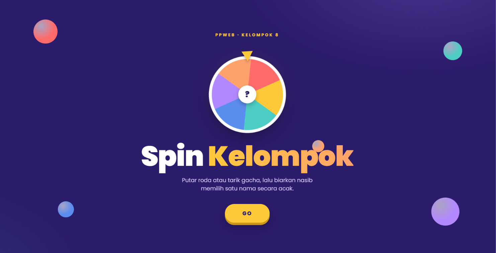
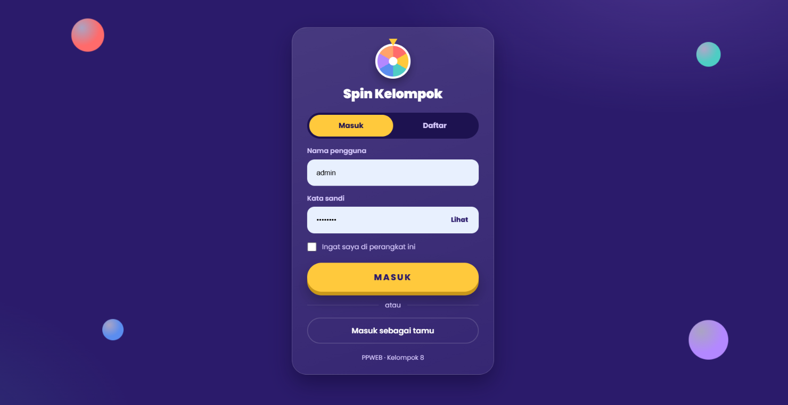
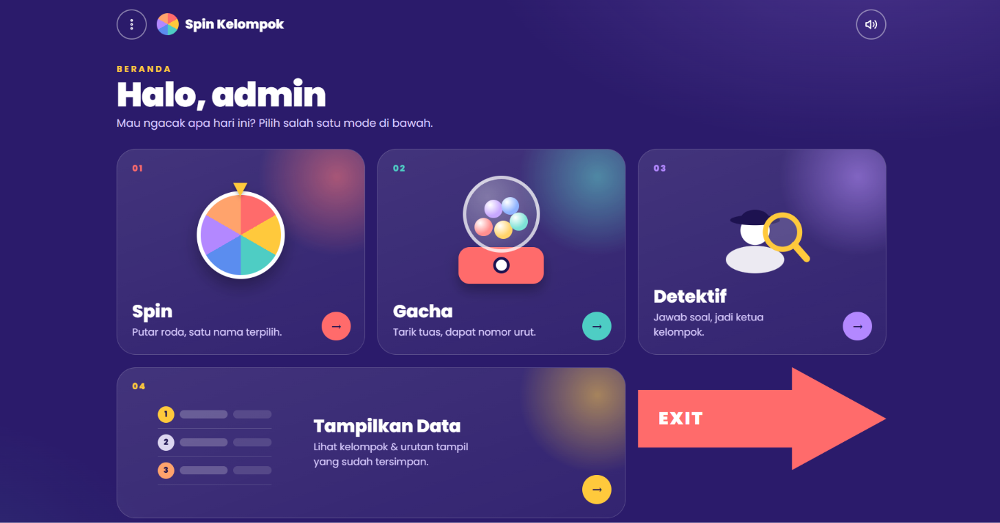
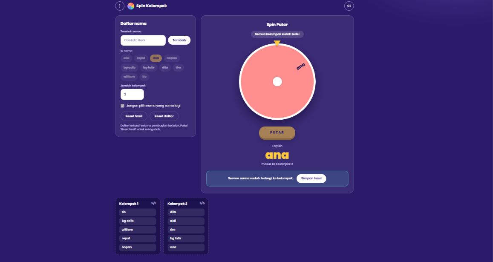
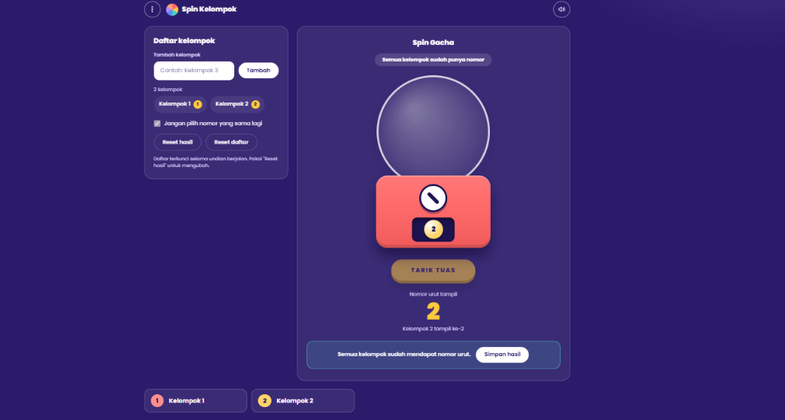
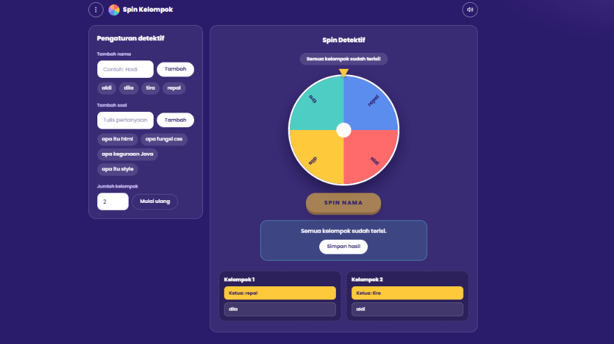
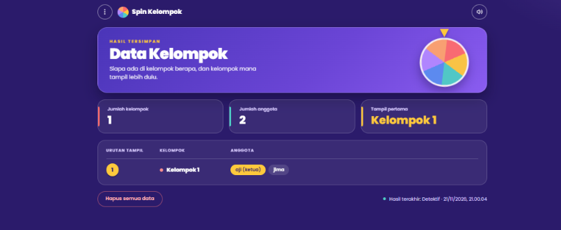

# ProjekWeb-PPWEB-Kelompok8

Proyek akhir mata kuliah **PPWEB** · **Kelompok 8**

## Anggota

- Seftira Ramadhani - 25076067
- Siti Fadhilah Rahman - 25076069

## Tentang proyek

Aplikasi web untuk membagi kelompok secara acak dan seru: putar roda, tarik gacha, atau tantang teman lewat mode detektif. Hasilnya tersimpan di database dan bisa dilihat kembali kapan saja.

## Fitur

- **Go**: halaman awal dengan roda berputar dan tombol masuk.
- **Login**: masuk, daftar akun, atau masuk sebagai **tamu**. Tersedia opsi "Ingat saya".
- **Beranda**: menu utama berbentuk kartu (Spin, Gacha, Detektif, Data) dan tombol Exit.
- **Spin Putar**: daftar nama diputar di roda, nama yang terpilih masuk ke kelompok secara berurutan. Ada opsi "Jangan pilih nama yang sama lagi".
- **Spin Gacha**: tiap kelompok mengambil bola bernomor dari mesin gacha untuk menentukan **urutan tampil**.
- **Detektif**: masukkan nama, soal, dan jumlah kelompok. Peserta yang terpilih menjawab soal. Jika benar, ia menjadi **ketua** dan memilih anggota kelompoknya. Jika gagal, giliran berpindah ke peserta berikutnya.
- **Data Kelompok**: melihat hasil yang tersimpan (urutan tampil, kelompok, anggota, ketua) dan menghapusnya.
- **Mode tamu**: bisa mencoba semua fitur, tetapi hasil tidak disimpan ke database.

## Alur halaman

```
Go → Login (Masuk / Daftar / Tamu) → Beranda → Spin Putar
                                              → Spin Gacha
                                              → Detektif
                                              → Data Kelompok
                                              → Exit (keluar dan kembali ke Go)
```

## Tangkapan layar

| Go | Login |
|----|-------|
|  |  |

| Beranda | Spin Putar |
|---------|------------|
|  |  |

| Spin Gacha | Detektif |
|------------|----------|
|  |  |

| Data Kelompok |
|---------------|
|  |

## Teknologi

- Frontend: HTML, CSS, JavaScript (tanpa framework), font Poppins
- Backend: PHP (PDO)
- Database: MySQL
- Server lokal: XAMPP (Apache + MySQL)
- Kolaborasi: Git dan GitHub (branch per fitur, Pull Request dengan review)

## Struktur folder

```
├── index.html        Halaman Go
├── login/            Login, daftar, tamu
├── beranda/          Menu utama
├── spin/             Spin Putar
├── gacha/            Spin Gacha
├── detektif/         Mode Detektif
├── data/             Data Kelompok
├── api/              Endpoint PHP (login, simpan hasil, ambil data, dll.)
├── database/         Skema database (schema.sql)
├── assets/           CSS dan JavaScript bersama
└── docs/             Dokumen perancangan dan screenshot
```

## Database

Tiga tabel:

| Tabel | Isi |
|-------|-----|
| `users` | akun pengguna (kata sandi disimpan dengan `password_hash`) |
| `sesi_spin` | satu baris setiap hasil disimpan: pemilik, jenis (`putar`, `gacha`, `detektif`), waktu |
| `hasil_kelompok` | nama kelompok, nama anggota, penanda ketua, dan urutan tampil |

## Kolaborasi

Pekerjaan dibagi menjadi dua bagian yang berjalan paralel. Setiap fitur dikerjakan di branch sendiri (`feature/...`), digabung lewat Pull Request, dan direview oleh anggota lain sebelum merge. Riwayat kerja bisa dilihat di tab **Pull requests** dan **Commits**.

## Cara menjalankan

1. Pasang **XAMPP** (Apache dan MySQL), lalu nyalakan keduanya di XAMPP Control Panel.
2. Clone repo ke folder `C:\xampp\htdocs\`:
   `git clone https://github.com/seftiraramadhani/ProjekWeb-PPWEB-Kelompok8.git`
3. Buka phpMyAdmin (`http://localhost/phpmyadmin`), klik tab **Impor**, lalu pilih file
   `database/schema.sql`. Ini otomatis membuat database `spin_kelompok` beserta tabelnya.
4. Salin `api/db.example.php` menjadi `api/db.php`. Port MySQL di proyek ini **3308**
   (lihat kolom Port di XAMPP Control Panel). Kalau MySQL kamu memakai port lain, ubah angka
   `port=3308` di `api/db.php`. Isi juga password kalau MySQL kamu memakainya.
5. Buka `http://localhost/ProjekWeb-PPWEB-Kelompok8/` di browser.

> `api/db.php` tidak ikut ke GitHub (ada di `.gitignore`), jadi setiap orang membuat sendiri.

### Kalau phpMyAdmin menolak tersambung

Biasanya port MySQL bukan 3306. Di `C:\xampp\phpMyAdmin\config.inc.php`, tambahkan di bawah baris `host`:
`$cfg['Servers'][$i]['port'] = '3308';`